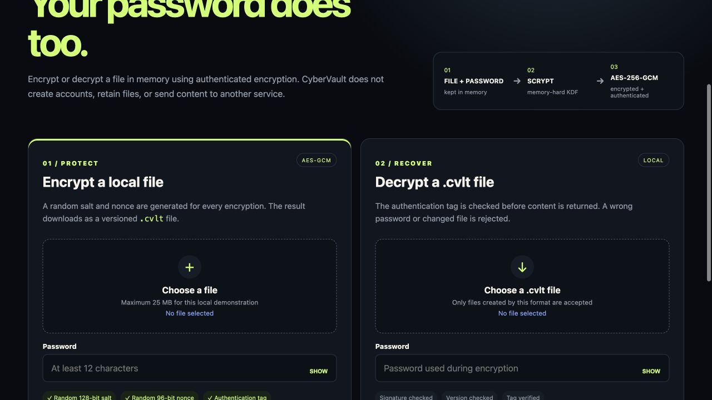

# CyberVault



CyberVault is a local Flask application that demonstrates password-derived,
authenticated file encryption. It uses scrypt to derive a 256-bit key and
AES-256-GCM to encrypt and authenticate file bytes entirely in memory.

## Problem addressed

Encryption examples often hide critical choices behind a single function call.
CyberVault makes the file format, password KDF, random salt, random nonce,
authentication tag, processing boundary, and limitations explicit.

## Features

- In-memory multipart handling plus encrypt/decrypt downloads with a 25 MB limit
- AES-256-GCM authenticated encryption
- scrypt memory-hard password-based key derivation
- Random 128-bit salt and 96-bit nonce for every encryption
- Versioned `CVLT` file envelope and tamper detection
- Security response headers, no-store caching, and loopback-only default server
- Nine automated tests for crypto behavior and Flask routes

## File format

Version 1 is `CVLT` magic (4 bytes), version (1 byte), salt (16 bytes), nonce
(12 bytes), and AES-GCM ciphertext with its 16-byte authentication tag. The
magic and version are authenticated as additional data. The password is never
stored in the file.

## Run locally

```bash
python3 -m venv .venv
source .venv/bin/activate
pip install -r requirements.txt
python app.py
```

Open `http://127.0.0.1:5000`. The Flask development server is only for local
demonstration, not public deployment.

## Test

```bash
pip install -r requirements-dev.txt
pytest
```

Verified result for this release: **9 tests passed**. The suite covers binary
round trips, fresh randomness, wrong passwords, tampering, malformed files,
security headers, input validation, and a route-level round trip.

## Security principles and limitations

See [SECURITY.md](SECURITY.md). CyberVault cannot recover a forgotten password,
secure a compromised computer, remove browser/download traces, protect a file
after decryption, or replace audited full-disk encryption and backup tools. The
application avoids writing uploaded content, but the browser saves requested
downloads and the operating system may use memory swap.

## Future improvements

- Chunked authenticated encryption for large files
- A migration path for future envelope versions
- Calibrated scrypt parameters based on local device performance
- Independent security review and cross-platform packaging
- Optional original filename metadata inside the authenticated envelope

## AI-assisted development disclosure

OpenAI Codex generated the initial cryptographic wrapper, tests, interface, and
documentation using established library primitives. The repository owner must
review, understand, and modify the work before describing personal technical
contributions. This project has not received an independent cryptographic audit
and should not be represented as one.

## License

[MIT](LICENSE)
